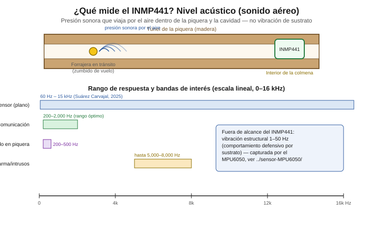

# INMP441 — Captura de audio I²S (nivel acústico / vitalidad de la colonia)

Sensor de audio aéreo del sistema KaabLab. El INMP441 es un micrófono MEMS
con salida digital **I²S** (no PDM), usado como proxy de **vitalidad y
estado general de la colonia** en *Melipona beecheii* — **no** de
comportamiento defensivo, el cual esta especie expresa por vibración de
sustrato y se captura con el MPU6050 (ver `../sensor-MPU6050/README.md` y
`CLAUDE.md`, sección "Decisiones de diseño confirmadas").

Documento dirigido a nivel licenciatura en mecatrónica: se explican tanto
los conceptos (Nyquist, trama I²S, canal mono) como la configuración
concreta para el ESP32 DevKit V1.

## Contenido de esta carpeta

| Archivo | Contenido |
|---|---|
| `README.md` | Este documento |
| `inmp441_i2s_capture.ino` | Configuración y lectura no bloqueante del driver I²S |
| `diagrama_conexion.svg` | Esquema de conexión ESP32 DevKit V1 ↔ INMP441 |
| `concepto_nivel_acustico.svg` | Diagrama conceptual: qué es el nivel acústico medido y su rango de frecuencia |

---

## 0. ¿Qué mide este sensor y en qué rango?



El INMP441 es un **micrófono MEMS**: su membrana responde a variaciones
de **presión sonora que viajan por el aire** dentro del tubo de la
piquera y la cavidad del nido — **sonido aéreo**, a diferencia de la
vibración mecánica del sustrato de la madera que capta el MPU6050 (ver
`../sensor-MPU6050/README.md`). En este proyecto se usa como proxy del
**nivel acústico general y la vitalidad de la colonia**, no del
comportamiento defensivo (que en *M. beecheii*, como en el resto de los
meliponinos, se expresa por vibración de sustrato, no por sonido aéreo —
dos Santos et al., 2025).

**Rango de respuesta plana: 60 Hz–15 kHz** (Suárez Carvajal, 2025).
Dentro de ese rango, el proyecto documenta tres bandas de interés
específicas (ver sección 1 más abajo para el detalle completo):

- **Comunicación acústica:** 200–2,000 Hz (rango óptimo del sensor)
- **Actividad de vuelo en piquera:** 200–500 Hz
- **Alarma / intrusos:** hasta 5,000–8,000 Hz

Las vibraciones estructurales de 1–50 Hz quedan **fuera del alcance** de
este micrófono de aire; por eso se complementa con el MPU6050.

---

## 1. Contexto: rango del sensor y bandas de interés

El INMP441 tiene una respuesta en frecuencia aproximadamente plana entre
**60 Hz y 15 kHz** (Suárez Carvajal, 2025; ver `CLAUDE.md` y
`thesis/capitulo-3-metodologia/capitulo-3.md`, Tabla de sensores). Dentro
de ese rango, el proyecto documenta tres bandas de interés específicas
para *M. beecheii*:

| Banda | Rango | Relación con el rango del sensor |
|---|---|---|
| Comunicación acústica | 200–2,000 Hz | Rango óptimo del INMP441 |
| Actividad de vuelo en piquera | 200–500 Hz | Dentro del rango óptimo |
| Alarma / intrusos | hasta 5,000–8,000 Hz | Extremo superior de interés, aún dentro del rango plano del sensor |

**Fuera de alcance del INMP441:** las vibraciones estructurales de
**1–50 Hz** (comportamiento defensivo por sustrato, dos Santos et al.
2025) quedan por debajo del rango útil de este micrófono de aire. Por eso
el proyecto usa una arquitectura sensorial complementaria: INMP441 para
audio aéreo (esta carpeta) + MPU6050 para vibración estructural (ver
`../sensor-MPU6050/`). Ningún sensor por sí solo cubre ambas bandas.

---

## 2. Configuración objetivo de muestreo

### 2.1 Sample rate y Nyquist

Por el **teorema de Nyquist**, para capturar sin pérdida (sin aliasing)
una señal hasta una frecuencia máxima `f_max`, se requiere:

```
sample_rate > 2 × f_max
```

La banda de interés más exigente del proyecto es la de alarma/intrusos,
hasta **8,000 Hz**. Eso exige:

```
Nyquist objetivo >= 8,000 Hz  =>  sample_rate >= 16,000 Hz
```

**Configuración recomendada: 16 kHz** (Nyquist = 8,000 Hz, justo en el
límite superior documentado — sin margen adicional) **o 22.05 kHz**
(Nyquist ≈ 11,025 Hz, con margen sobre los 8,000 Hz) si el
almacenamiento/ancho de banda del proyecto lo permite. Ambas son tasas
estándar de audio, compatibles con librerías de procesamiento (extracción
de MFCCs, ver `thesis/capitulo-3-metodologia/capitulo-3.md`, sección
3.2.2) sin necesidad de resampleo. Este documento usa **16 kHz** como
configuración por defecto en el código (sección 3); cambiar a 22.05 kHz
es un solo cambio de constante si el bench de la sección 5 lo justifica.

### 2.2 Por qué el INMP441 no tiene la limitación de Nyquist interno del MPU6050

El MPU6050 (ver `../sensor-MPU6050/README.md`, sección 2.2) tiene una
limitación de hardware documentada: su ADC de aceleración actualiza su
valor internamente a **1 kHz fijo**, sin importar la tasa a la que el
firmware lea el registro — leer más rápido que eso solo produce muestras
repetidas.

**El INMP441 no tiene esa limitación.** Según el datasheet de
InvenSense/TDK (ver Referencias), el INMP441 no tiene un reloj de
muestreo interno independiente del bus I²S: el micrófono deriva su
temporización directamente del **bit clock (SCK)** y el **word select
(WS)** suministrados por el maestro I²S (en este proyecto, el ESP32). El
filtro de decimación interno del sensor produce una palabra PCM nueva por
cada ciclo de WS — es decir, **la tasa de muestreo efectiva es
exactamente la que el ESP32 configura como `sample_rate` del driver I²S**,
sin submuestreo interno oculto ni repetición de muestras.

> **Punto a validar (ver sección 5):** esta afirmación describe el
> comportamiento documentado del protocolo I²S y del datasheet del
> INMP441; se deja como validación de banco (no solo de datasheet)
> confirmar que la señal capturada a 16 kHz efectivamente contiene
> información nueva en cada muestra y no artefactos de la implementación
> del driver I²S del ESP32.

### 2.3 Formato de datos: 24 bits en trama de 32, I²S estándar (no PDM)

El INMP441 transmite **24 bits válidos de audio**, alineados a la
izquierda dentro de una **trama I²S de 32 bits** por canal — protocolo
I²S estándar (Philips I2S), no PDM (Pulse-Density Modulation, usado por
otros micrófonos MEMS como el SPH0645 en modo alterno). Esto significa
que el firmware debe:

- Configurar el driver para tramas de 32 bits (`I2S_BITS_PER_SAMPLE_32BIT`).
- Extraer los 24 bits válidos desplazando el valor leído (`>>8` en el caso
  típico; ver nota de validación en el código, sección 3, sobre un
  corrimiento de bit conocido en algunas versiones del periférico I²S del
  ESP32).

El bit clock (SCK) típico para este formato es 64× la tasa de muestreo
(32 bits × 2 slots de canal en el frame I²S, incluso en modo mono, donde
el micrófono solo emite datos válidos en el slot seleccionado por L/R).

### 2.4 Canal mono: L/R a GND

El pin **L/R** del INMP441 selecciona en qué slot del frame I²S (izquierdo
o derecho) el sensor coloca sus datos. Conectado a **GND**, selecciona el
**canal izquierdo**. Con un solo micrófono por colmena, un canal mono es
suficiente — no se requiere el canal derecho ni un segundo INMP441 en la
misma línea I²S para este proyecto.

---

## 3. Código de manejo del sensor (ESP32)

Ver [`inmp441_i2s_capture.ino`](./inmp441_i2s_capture.ino).

Pin mapping confirmado del proyecto (`CLAUDE.md`,
`thesis/capitulo-3-metodologia/capitulo-3.md` Tabla 3.3):

| Señal | Pin ESP32 |
|---|---|
| SCK (bit clock) | GPIO14 |
| WS (word select / LRCLK) | GPIO15 |
| SD (datos) | GPIO32 |
| L/R | GND |

Puntos clave del código:

- Usa el driver I²S clásico de ESP-IDF (`driver/i2s.h`), incluido en el
  core Arduino-ESP32 2.x. El archivo incluye una nota sobre migración a
  la API `i2s_std` si el proyecto usa el core 3.x (ESP-IDF v5).
- Configura `sample_rate = 16000`, `bits_per_sample =
  I2S_BITS_PER_SAMPLE_32BIT`, `channel_format = I2S_CHANNEL_FMT_ONLY_LEFT`,
  `communication_format = I2S_COMM_FORMAT_STAND_I2S` (secciones 2.1–2.4).
- La lectura del buffer I²S usa `i2s_read(..., ticks_to_wait = 0)`: es
  **no bloqueante**, retorna de inmediato con lo que ya esté disponible en
  el buffer DMA interno del periférico, sin detener el bucle principal ni
  bloquear otras tareas del ESP32 (WiFi, lectura de otros sensores).
- Extrae los 24 bits válidos de cada muestra de 32 bits (`>>8`) e imprime
  timestamp + valor por puerto serie en formato CSV, listo para capturar
  y analizar (p. ej. verificar aliasing/saturación) en banco.

---

## 4. Esquema de conexión

Ver [`diagrama_conexion.svg`](./diagrama_conexion.svg).

Incluye: VDD (3.3V), GND, SCK (GPIO14), WS (GPIO15), SD (GPIO32), y L/R
(a GND, canal mono).

---

## 5. Validación requerida antes de instalación en campo

**No dar por resuelta esta configuración únicamente por inspección de
código o datasheet.** Antes de instalar el sensor en una colmena, se
requiere una prueba de banco que confirme, grabando un **tono conocido**
(generador de audio calibrado) o el **zumbido de vuelo real** de la
colonia:

1. **Ausencia de aliasing**: al grabar un tono de frecuencia conocida
   cercana al límite superior de interés (~8,000 Hz), la FFT de la señal
   capturada debe mostrar el pico en la frecuencia correcta, sin
   componentes espurios por debajo de él que indiquen plegamiento
   espectral.
2. **Ausencia de saturación (clipping)**: verificar que la amplitud de la
   señal capturada, tanto del tono de prueba como del zumbido real de la
   colonia a la distancia de instalación prevista, no alcanza los
   extremos del rango de 24 bits de forma sostenida.
3. **Confirmación del corrimiento de bits correcto** (`>>8` vs. `>>11` u
   otro, ver nota en el código, sección 3): comparar la amplitud
   reportada contra la esperada para el nivel de presión sonora (SPL)
   conocido del tono de prueba.
4. **Confirmación de la tasa de muestreo real**: contar muestras
   recibidas por segundo contra las 16,000 configuradas, para descartar
   pérdida de muestras en el driver I²S o en el manejo del buffer DMA.
5. Si el bench muestra energía significativa cerca de los 8,000 Hz con
   evidencia de aliasing, o si se decide capturar señales de alarma por
   encima de ese límite, reconfigurar a 22.05 kHz o superior (sección 2.1)
   antes de continuar.

Solo después de esta validación de banco se debe considerar la
configuración lista para cableado final en campo.

---

## Referencias

- Suárez Carvajal, S. (2025). [Título completo pendiente — micrófono MEMS
  aplicado a *Melipona eburnea*]. Ver `thesis/referencias.md`.
- dos Santos, [...]. et al. (2025). [Título completo pendiente —
  vibración de sustrato / comportamiento defensivo en meliponinos]. Ver
  `thesis/referencias.md`.
- InvenSense / TDK. *INMP441 — Omnidirectional Microphone with Bottom
  Port and I²S Digital Output*, datasheet, sección de generación de reloj
  (clock generation) y formato de trama I²S. Confirmar edición/revisión
  exacta del documento antes de la entrega final de la tesis (mismo
  criterio de `thesis/referencias.md` para citas con datos bibliográficos
  pendientes de verificar).
