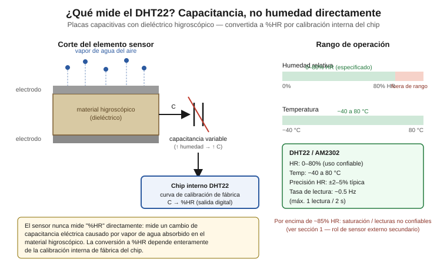

# DHT22 (AM2302) — Temperatura y humedad, sensor externo secundario

Sensor de temperatura y humedad relativa del sistema KaabLab, instalado
**fuera** de la colmena como referencia ambiental externa. Se usa junto
con el SHT31 interno (ver `../sensor-temperatura-humedad-precision/`)
dentro de una arquitectura sensorial heterogénea de temperatura/humedad
(sección 1).

Documento dirigido a nivel licenciatura en mecatrónica: se explica tanto
el principio físico del sensor (capacitivo) como la configuración
concreta para el ESP32 DevKit V1.

## Contenido de esta carpeta

| Archivo | Contenido |
|---|---|
| `README.md` | Este documento |
| `dht22_lectura.ino` | Lectura de temperatura y humedad con la librería DHT sensor library |
| `diagrama_conexion.svg` | Esquema de conexión ESP32 DevKit V1 ↔ DHT22 |
| `concepto_capacitivo_dht22.svg` | Diagrama conceptual: principio capacitivo higroscópico y rango de operación |

---

## 0. ¿Qué mide este sensor y en qué rango?



El DHT22 **no mide humedad directamente**. Es un sensor **capacitivo**:
su elemento sensor es un par de electrodos que forman un capacitor con
un **material higroscópico** como dieléctrico entre ellos. Ese material
absorbe o libera vapor de agua del aire según la humedad ambiente, y esa
absorción cambia la **permitividad eléctrica** del dieléctrico y, por lo
tanto, la **capacitancia** medida entre los electrodos. Un chip interno,
con una curva de calibración de fábrica, convierte esa capacitancia (y
una lectura de temperatura de un termistor interno) a los valores de
temperatura y %HR que el sensor entrega por su línea de datos.

**Rangos especificados:**

- **Humedad relativa: 0–80% HR** (uso confiable; por encima de ~85% HR
  el sensor se satura y deja de responder de forma fiable — ver sección 1)
- **Temperatura: −40 a 80 °C**
- Precisión típica de HR: ±2–5% (varía según el lote/fabricante)
- Tasa máxima de lectura: ~0.5 Hz (una lectura cada 2 segundos)

---

## 1. ¿Por qué dos sensores de temperatura/humedad?

El proyecto no usa el DHT22 y el SHT31 como redundancia simple (dos
sensores midiendo lo mismo para promediar). Es una **arquitectura
sensorial heterogénea** con tres justificaciones independientes:

- **Complementariedad de rango:** el DHT22 se satura por encima de
  ~85% HR, una condición frecuente en temporada de lluvias en Campeche
  (mayo–octubre). El SHT31 cubre 0–100% HR sin saturación, por lo que
  el sistema conserva una lectura confiable del microclima interno de
  la colmena incluso cuando la humedad ambiental externa excede el
  rango útil del DHT22.
- **Detección de deriva sin inspección física:** la divergencia
  creciente entre ambas lecturas —causada por contaminación de
  propóleos y envejecimiento del material higroscópico del DHT22— es
  una señal automática y continua de que el DHT22 necesita limpieza o
  reemplazo, sin depender de una inspección manual periódica de la
  colmena.
- **Redundancia heterogénea:** los dos sensores provienen de
  fabricantes distintos (Aosong vs. Sensirion) con principios de
  fabricación distintos, lo que elimina modos de falla comunes: un
  defecto de lote, una falla de calibración o una degradación
  específica de un fabricante no afecta a ambos sensores por igual.

---

## 2. ¿Por qué se mide temperatura?

La temperatura no es solo un dato ambiental adicional: es necesaria
para dos usos concretos en el pipeline del proyecto.

1. **Compensación interna de la lectura de %HR.** El chip de cada
   sensor usa la temperatura medida para corregir su propia lectura de
   humedad relativa antes de entregarla — la relación entre
   capacitancia y %HR depende de la temperatura del elemento sensor, no
   solo de la humedad ambiente.
2. **Cálculo de humedad absoluta.** La humedad relativa depende de la
   temperatura: la misma cantidad real de vapor de agua produce
   lecturas de %HR distintas según la temperatura ambiente. Por eso el
   pipeline de fusión del proyecto convierte temperatura + %HR a
   **humedad absoluta (HA, en g/m³)** mediante la aproximación de
   Magnus, ya usada en el proyecto (ver
   `thesis/capitulo-3-metodologia/capitulo-3.md`, sección 3.4.5):

   ```
   HA = 6.112 × e^(17.67·T / (T+243.5)) × HR / (461.5 × (T+273.15))
   ```

   donde `T` es la temperatura en °C y `HR` la humedad relativa en
   tanto por uno. La humedad absoluta es la magnitud realmente
   relevante para la salud de la colmena (desarrollo de hongos,
   ventilación colectiva), porque representa el contenido real de vapor
   de agua **independientemente de la temperatura** — a diferencia de
   la humedad relativa, que varía con la temperatura aunque el
   contenido de vapor no cambie.

---

## 3. Código de manejo del sensor (ESP32)

Ver [`dht22_lectura.ino`](./dht22_lectura.ino).

Usa la librería **DHT sensor library** de Adafruit (requiere la
dependencia "Adafruit Unified Sensor", instalable junto con ella desde
el Library Manager de Arduino).

Puntos clave del código:

- El DHT22 usa un **protocolo digital propietario de un solo hilo**
  (no I²C, no 1-Wire estándar Dallas): el ESP32 envía un pulso de
  inicio y el sensor responde con una trama de 40 bits codificados por
  ancho de pulso. La librería maneja este timing crítico internamente
  mediante bit-banging con `micros()`; el sketch no necesita
  implementarlo a mano.
- **Pin de datos: GPIO4** (`DHTPIN 4`, `DHTTYPE DHT22`).
- Respeta el **límite de tasa del sensor** (~0.5 Hz) con temporización
  no bloqueante basada en `millis()` — no usa `delay()` largo en el
  bucle principal, dejando espacio para otras tareas del ESP32.
- Verifica `isnan()` en cada lectura: una lectura fallida del
  protocolo (ruido eléctrico, cableado, timing) devuelve `NAN` en vez
  de un valor numérico, y debe descartarse en vez de propagarse al
  pipeline de fusión.
- Imprime timestamp + temperatura + humedad por puerto serie en
  formato CSV. La conversión a humedad absoluta y el contraste con el
  SHT31 (secciones 1 y 2) se calculan en la capa de fusión del
  proyecto, no en este sketch de adquisición.

---

## 4. Esquema de conexión

Ver [`diagrama_conexion.svg`](./diagrama_conexion.svg).

Incluye: VCC (3.3–5V), GND, DATA (GPIO4), y la resistencia pull-up de
10 kΩ entre DATA y VCC requerida por el protocolo del sensor (muchos
módulos AM2302/DHT22 ya la incluyen integrada en la placa — verificar
antes de añadir una externa).

---

## 5. Nota de validación

Este sensor **no requiere una prueba de banco crítica** como
`sensor-trafico` o `sensor-vibracion`: es una arquitectura de
temperatura/humedad ya validada en la tesis (ver
`thesis/capitulo-3-metodologia/capitulo-3.md`, sección 3.2.1), con
componentes comerciales de comportamiento bien documentado.

Sí se requiere, una vez instalado en campo:

- **Verificar la divergencia DHT22 vs. SHT31** como diagnóstico
  continuo de deriva (sección 1): registrar ambas lecturas desde la
  instalación y confirmar que la diferencia se mantiene dentro del
  desfase esperado por la separación interior/exterior, sin una
  tendencia creciente sostenida que indique contaminación o
  envejecimiento del DHT22.
- Confirmar en campo que el DHT22 externo queda protegido de lluvia
  directa y de radiación solar directa, condiciones que pueden
  introducir error de lectura no relacionado con la deriva del propio
  sensor.

---

## Referencias

- Aosong (Guangzhou) Electronics. *Digital-output relative humidity &
  temperature sensor/module DHT22 (AM2302)* — datasheet, rangos de
  operación y protocolo de un solo hilo.
- `thesis/capitulo-3-metodologia/capitulo-3.md`, secciones 3.2.1
  (fundamento físico SHT31/DHT22), 3.2.4 (fusión ponderada por
  confianza) y 3.4.5 (conversión a humedad absoluta, fórmula de
  Magnus).
- `CLAUDE.md`, sección "Decisiones de diseño confirmadas".
