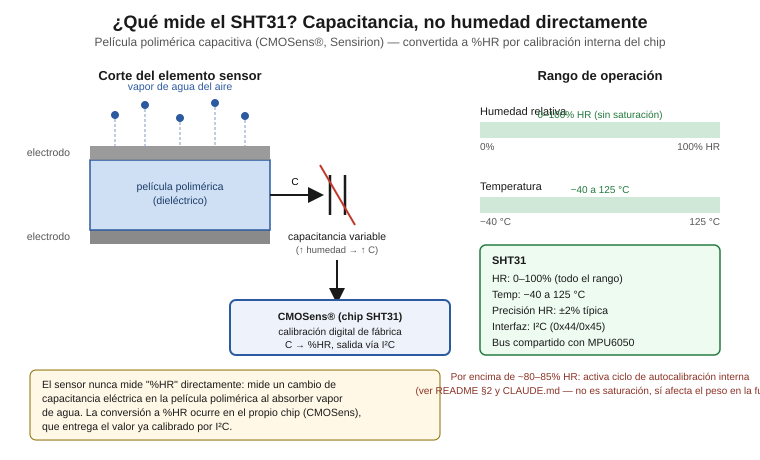

# SHT31 — Temperatura y humedad, sensor interno primario

Sensor de temperatura y humedad relativa del sistema KaabLab, instalado
**dentro** de la cavidad del nido como sensor primario del microclima
interno. Se usa junto con el DHT22 externo (ver
`../sensor-temperatura-humedad-basico/`) dentro de una arquitectura
sensorial heterogénea de temperatura/humedad (sección 1).

Documento dirigido a nivel licenciatura en mecatrónica: se explica tanto
el principio físico del sensor (capacitivo) como la configuración
concreta para el ESP32 DevKit V1.

## Contenido de esta carpeta

| Archivo | Contenido |
|---|---|
| `README.md` | Este documento (conceptual, independiente de plataforma) |
| `concepto_capacitivo_sht31.svg` | Diagrama conceptual: principio capacitivo de película polimérica y rango de operación |
| `arduino/sht31_lectura.ino` | Lectura de temperatura y humedad vía I²C con Adafruit SHT31 Library (ESP32) |
| `arduino/diagrama_conexion.svg` | Esquema de conexión ESP32 DevKit V1 ↔ SHT31 |
| `raspberry/` | Código Python y diagrama de conexión Raspberry Pi — pendiente, ver `docs/arquitectura-hardware/README.md` |

---

## 0. ¿Qué mide este sensor y en qué rango?



El SHT31 **no mide humedad directamente**. Es un sensor **capacitivo**:
su elemento sensor es un par de electrodos que forman un capacitor con
una **película polimérica** como dieléctrico entre ellos (tecnología
CMOSens® de Sensirion). Esa película absorbe o libera vapor de agua del
aire según la humedad ambiente, y esa absorción cambia la
**permitividad eléctrica** del dieléctrico y, por lo tanto, la
**capacitancia** medida entre los electrodos. El chip integrado, con
calibración digital de fábrica, convierte esa capacitancia (junto con
una lectura de temperatura interna) a los valores de temperatura y %HR
que el sensor entrega por I²C.

**Rangos especificados:**

- **Humedad relativa: 0–100% HR**, sin saturación en todo el rango
- **Temperatura: −40 a 125 °C**
- **Precisión: ±2% HR** en todo el rango 0–100%
- Interfaz: I²C, direcciones 0x44/0x45

Por encima de ~80–85% HR el SHT31 activa un ciclo de autocalibración
interna (no es saturación: sigue reportando valores, pero con menor
confiabilidad momentánea durante el evento) — ver `CLAUDE.md`, sección
"Decisiones de diseño confirmadas", y la sección 2 de este documento.

---

## 1. ¿Por qué dos sensores de temperatura/humedad?

El proyecto no usa el DHT22 y el SHT31 como redundancia simple (dos
sensores midiendo lo mismo para promediar). Es una **arquitectura
sensorial heterogénea** con tres justificaciones independientes:

- **Complementariedad de rango:** el DHT22 se satura por encima de
  ~85% HR, una condición frecuente en temporada de lluvias en Campeche
  (mayo–octubre). El SHT31 cubre 0–100% HR sin saturación, por lo que
  el sistema conserva una lectura confiable del microclima interno de
  la colmena incluso cuando la humedad ambiental externa excede el
  rango útil del DHT22.
- **Detección de deriva sin inspección física:** la divergencia
  creciente entre ambas lecturas —causada por contaminación de
  propóleos y envejecimiento del material higroscópico del DHT22— es
  una señal automática y continua de que el DHT22 necesita limpieza o
  reemplazo, sin depender de una inspección manual periódica de la
  colmena.
- **Redundancia heterogénea:** los dos sensores provienen de
  fabricantes distintos (Aosong vs. Sensirion) con principios de
  fabricación distintos, lo que elimina modos de falla comunes: un
  defecto de lote, una falla de calibración o una degradación
  específica de un fabricante no afecta a ambos sensores por igual.

---

## 2. ¿Por qué se mide temperatura?

La temperatura no es solo un dato ambiental adicional: es necesaria
para dos usos concretos en el pipeline del proyecto.

1. **Compensación interna de la lectura de %HR.** El chip CMOSens del
   SHT31 usa la temperatura medida internamente para corregir su propia
   lectura de humedad relativa antes de entregarla por I²C — la
   relación entre capacitancia y %HR depende de la temperatura del
   elemento sensor, no solo de la humedad ambiente. Esta compensación
   ocurre dentro del chip, antes de que el ESP32 reciba el dato.
2. **Cálculo de humedad absoluta.** La humedad relativa depende de la
   temperatura: la misma cantidad real de vapor de agua produce
   lecturas de %HR distintas según la temperatura ambiente. Por eso el
   pipeline de fusión del proyecto convierte temperatura + %HR a
   **humedad absoluta (HA, en g/m³)** mediante la aproximación de
   Magnus, ya usada en el proyecto (ver
   `thesis/capitulo-3-metodologia/capitulo-3.md`, sección 3.4.5):

   ```
   HA = 6.112 × e^(17.67·T / (T+243.5)) × HR / (461.5 × (T+273.15))
   ```

   donde `T` es la temperatura en °C y `HR` la humedad relativa en
   tanto por uno. La humedad absoluta es la magnitud realmente
   relevante para la salud de la colmena (desarrollo de hongos,
   ventilación colectiva), porque representa el contenido real de vapor
   de agua **independientemente de la temperatura** — a diferencia de
   la humedad relativa, que varía con la temperatura aunque el
   contenido de vapor no cambie.

---

## 3. Código de manejo del sensor

Arquitectura dual del nodo de borde (ver `docs/arquitectura-hardware/README.md`):
código Arduino/ESP32 vigente en [`arduino/`](./arduino/); código Python
para Raspberry Pi pendiente en [`raspberry/`](./raspberry/).

### 3.1 ESP32 / Arduino

Ver [`arduino/sht31_lectura.ino`](./arduino/sht31_lectura.ino).

Pin mapping confirmado del proyecto: **SDA = GPIO21, SCL = GPIO22**
(bus I²C compartido con el MPU6050, ver `../sensor-vibracion/README.md`).

Usa la librería **Adafruit SHT31 Library** (requiere la dependencia
"Adafruit Unified Sensor", instalable junto con ella desde el Library
Manager de Arduino).

Puntos clave del código:

- Inicializa el bus con `Wire.begin(21, 22)` y el sensor con
  `sht31.begin(0x44)` — dirección I²C con `ADDR` a GND (ver diagrama de
  conexión). Sin conflicto con el MPU6050/6500 en el mismo bus
  (0x68/0x69).
- `readTemperature()` / `readHumidity()` disparan una medición nueva en
  el chip CMOSens y leen el resultado ya calibrado y compensado por
  temperatura vía I²C — no requieren timing manual como el DHT22.
- Verifica `isnan()` en cada lectura para descartar fallas de
  comunicación I²C en vez de propagarlas al pipeline de fusión.
- Imprime timestamp + temperatura + humedad por puerto serie en
  formato CSV. La conversión a humedad absoluta y el contraste con el
  DHT22 (secciones 1 y 2) se calculan en la capa de fusión del
  proyecto, no en este sketch de adquisición.

---

## 4. Esquema de conexión

Ver [`arduino/diagrama_conexion.svg`](./arduino/diagrama_conexion.svg) (ESP32 DevKit V1).

Incluye: VCC (3.3V), GND, SDA (GPIO21), SCL (GPIO22), y el pin `ADDR`
(a GND en este proyecto, para dirección 0x44).

El esquema de conexión para Raspberry Pi (mapeo GPIO BCM) se agregará en
`raspberry/` en una tarea posterior; el mapeo de pines ya documentado
está en `docs/arquitectura-hardware/README.md`, sección 4.

---

## 5. Nota de validación

Este sensor **no requiere una prueba de banco crítica** como
`sensor-trafico` o `sensor-vibracion`: es una arquitectura de
temperatura/humedad ya validada en la tesis (ver
`thesis/capitulo-3-metodologia/capitulo-3.md`, sección 3.2.1), con
componentes comerciales de comportamiento bien documentado.

Sí se requiere, una vez instalado en campo:

- **Verificar la divergencia DHT22 vs. SHT31** como diagnóstico
  continuo de deriva (sección 1): registrar ambas lecturas desde la
  instalación y confirmar que la diferencia se mantiene dentro del
  desfase esperado por la separación interior/exterior, sin una
  tendencia creciente sostenida que indique contaminación o
  envejecimiento del DHT22.
- Confirmar en campo que la frecuencia de eventos de autocalibración
  interna (por encima de ~80–85% HR, sección 0) es consistente con lo
  esperado por la fusión ponderada por confianza (ver
  `thesis/capitulo-3-metodologia/capitulo-3.md`, sección 3.2.4, Paso 1).

---

## Referencias

- Sensirion AG. *Datasheet SHT3x-DIS* — tecnología CMOSens®, rangos de
  operación, direcciones I²C y comportamiento de autocalibración.
- `thesis/capitulo-3-metodologia/capitulo-3.md`, secciones 3.2.1
  (fundamento físico SHT31/DHT22), 3.2.4 (fusión ponderada por
  confianza) y 3.4.5 (conversión a humedad absoluta, fórmula de
  Magnus).
- `CLAUDE.md`, sección "Decisiones de diseño confirmadas".
