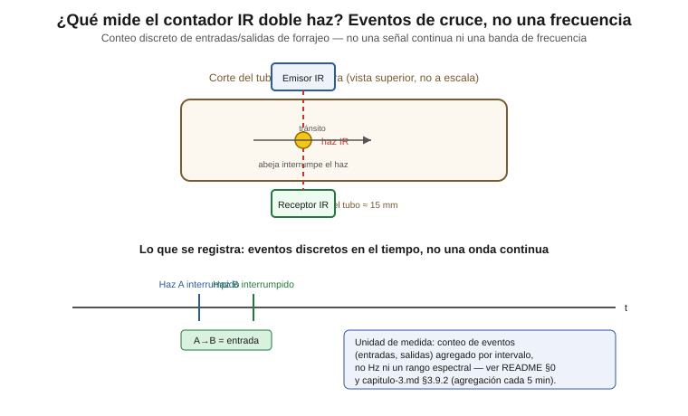

# Contador IR doble haz (TCRT5000 reflectivo) — conteo direccional de tráfico en piquera

Sensor de conteo de tráfico de forrajeo del sistema KaabLab. A diferencia
del INMP441 y el MPU6050 (ver `../sensor-audio/` y `../sensor-vibracion/`),
este sensor no mide una magnitud continua con un rango de frecuencia: mide
**eventos discretos de cruce** (entrada/salida) por la piquera, usados
como proxy de la actividad de forrajeo y la vitalidad general de la
colonia.

Documento dirigido a nivel licenciatura en mecatrónica: se explican tanto
los conceptos (interrupción de haz, debounce, lógica de secuencia) como
la configuración concreta para el ESP32 DevKit V1.

> **Este documento describe un punto de diseño no cerrado, no una
> configuración validada.** Las secciones 1 y 2 documentan una limitación
> crítica pendiente de resolver en banco antes de instalar en campo.

## Contenido de esta carpeta

| Archivo | Contenido |
|---|---|
| `README.md` | Este documento |
| `arduino/ir_doble_haz_conteo/ir_doble_haz_conteo.ino` | Lectura digital con debounce y lógica de secuencia direccional |
| `arduino/diagrama_conexion.svg` | Esquema de conexión ESP32 DevKit V1 ↔ módulos TCRT5000 |
| `concepto_deteccion.svg` | Diagrama conceptual: qué es un evento de cruce y cómo se detecta |
| `raspberry/conteo_trafico.py` | Equivalente Python por detección de eventos `RPi.GPIO` (opcional, fuera de la tesis) |
| `raspberry/diagrama_conexion.svg` | Esquema de conexión Raspberry Pi 4 (GPIO BCM, ver `docs/arquitectura-hardware/README.md`) |

> **Cómo abrir el sketch:** el Arduino IDE exige que cada `.ino` esté en una carpeta con su mismo nombre. Abrir `arduino/ir_doble_haz_conteo/ir_doble_haz_conteo.ino` desde su propia carpeta (Archivo → Abrir), no la carpeta del sensor. Requiere solo el core **esp32** de Espressif (Boards Manager → "esp32"), placa *ESP32 Dev Module*; no usa librerías externas.
>
> **Variante Raspberry Pi (opcional):** `pip install RPi.GPIO`.

---

## 0. ¿Qué mide este sensor y en qué rango?

El contador IR doble haz **no mide una magnitud física continua con un
rango de frecuencia o amplitud**, a diferencia del INMP441 (60 Hz–15 kHz)
o el MPU6050 (300–600 Hz objetivo). Mide **eventos discretos**: cada vez
que una abeja cruza el tubo de la piquera, pasa primero por la zona de
detección de un haz y luego por la del otro (cada módulo la detecta por la
luz IR que refleja su cuerpo), en un orden que depende de si entra o sale.
Lo que se registra es un **conteo de eventos por unidad de tiempo**
(entradas y salidas agregadas por intervalo, típicamente cada 5 minutos —
ver `thesis/capitulo-2-materiales-y-metodos/capitulo-2.md`, sección 2.9.2), no una
señal de audio o vibración que deba muestrearse a una tasa fija.

La "unidad de medida" relevante aquí no es Hz sino:

- **Eventos de entrada** (secuencia Haz A → Haz B)
- **Eventos de salida** (secuencia Haz B → Haz A)
- **Tasa neta** (entradas − salidas) por intervalo de agregación

---

## 1. Contexto del problema (pendiente real, diseño no cerrado)

La arquitectura vigente para este sensor usa **módulos comerciales con
TCRT5000**, un sensor óptico **reflectivo**: emisor IR y fototransistor en
el mismo encapsulado, más comparador **LM393** y un potenciómetro en la
placa para ajustar la sensibilidad/umbral de disparo.

**Rango de detección:** el rango de operación declarado por el fabricante del TCRT5000 (hoja de datos Vishay): 0.2–15 mm, pico a 2.5 mm — pendiente de validar en banco. El tubo de la
piquera mide **~15 mm**, en el límite superior de ese rango. No hay
garantía, solo por lectura de la hoja de datos, de que el módulo comercial
detecte de forma confiable el cuerpo de la abeja dentro del tubo, ni de
que el reflejo de la pared opuesta no dispare la salida. **Este es un
punto crítico de validación en banco antes de instalar (sección 5), no un
diseño cerrado.**

### 1.1 Nota sobre la arquitectura física del doble haz con módulos integrados

**Confirmado:** el proyecto usa 4 módulos TCRT5000 reflectivos, 2 por
haz. Cada módulo emite y recibe por la misma cara y detecta la abeja por
reflexión: **no se forma un haz directo entre módulos**. Los **dos haces
independientes y espacialmente separados** que requiere la lógica de
conteo direccional (Haz A y Haz B, separación ≥ ~10 mm (ancho de la cabeza óptica del TCRT5000, única parte que va en la piquera; la placa queda en la caja, no se cuenta su ancho), a validar, a lo largo del
eje del túnel — ver `thesis/capitulo-2-materiales-y-metodos/capitulo-2.md`,
sección 2.2.3) son en realidad dos zonas de detección, cada una vigilada
por dos módulos.

Cada módulo tiene su propio fototransistor y produce una señal `OUT`
utilizable. Por eso se conectan al ESP32 las dos señales `OUT` de cada
haz (una declarada "principal" y la otra "secundaria"), en vez de una
sola: esto permite, durante la validación de banco (sección 5), comparar
ambas lecturas, detectar diafonía (el LED de un módulo saturando el
receptor del otro si quedan cara a cara) o decidir cuál de las dos
señales resulta más limpia para el conteo final. Solo la alimentación (VCC/GND) es compartida sin necesidad de
señal adicional al ESP32. Ver el esquema de conexión (sección 4) para el
detalle de pines.

El uso de 4 módulos con 4 señales digitales (en vez de 2) responde a la
redundancia y al diagnóstico en banco, no a formar un haz directo; la
geometría de montaje (posición de cada módulo en el barreno y separación
≥ ~10 mm (ancho de la cabeza óptica del TCRT5000, única parte que va en la piquera; la placa queda en la caja, no se cuenta su ancho), a validar) es otro punto a confirmar físicamente en el montaje real
antes de dar el diseño por cerrado.

---

## 2. Riesgo adicional: falsos positivos por luz solar IR

Los módulos TCRT5000 **no tienen mitigación integrada** contra luz
solar directa u otras fuentes de IR ambiental (a diferencia de un diseño
con modulación IR activa, donde el receptor solo responde a un LED
emisor pulsado a una frecuencia conocida, rechazando luz IR continua de
fondo). En este diseño, la única barrera contra falsos positivos por luz
solar es el **blindaje mecánico del tubo de madera** de la piquera: al
estar el sensor embebido dentro del barreno, se asume que la madera
bloquea la luz solar directa sobre el fototransistor.

Esto es una asunción, no una validación. Si el tubo tiene alguna
filtración de luz (por ejemplo, en el extremo exterior expuesto a la
piquera abierta), el sensor puede generar conteos falsos durante horas de
sol intenso. Debe probarse explícitamente en banco (sección 5).

---

## 3. Código de manejo del sensor (ESP32)

Ver [`arduino/ir_doble_haz_conteo/ir_doble_haz_conteo.ino`](./arduino/ir_doble_haz_conteo/ir_doble_haz_conteo.ino).

Pin mapping confirmado del proyecto:

| Señal | Pin ESP32 |
|---|---|
| Haz A — receptor principal | GPIO26 |
| Haz A — receptor secundario (mismo par, diagnóstico) | GPIO25 |
| Haz B — receptor principal | GPIO27 |
| Haz B — receptor secundario (mismo par, diagnóstico) | GPIO33 |

GPIO25 quedó libre para este uso porque el diseño discreto anterior (que
lo usaba como línea de drive de un LED IR) fue descartado en favor de los
módulos TCRT5000 — ver `CLAUDE.md`, sección "Decisiones de diseño
confirmadas". GPIO33 es un GPIO de propósito general sin uso previo en el
mapeo de pines del proyecto (ver `thesis/capitulo-2-materiales-y-metodos/capitulo-2.md`,
Tabla 2.3), sin conflicto con I²C (21/22), I²S (14/15/32) ni el protocolo propio de un
hilo del DHT22 (4).

Puntos clave del código:

- **Lectura digital simple** de las 4 señales (`HAZ_A_PIN`, `HAZ_A_SEC_PIN`,
  `HAZ_B_PIN`, `HAZ_B_SEC_PIN`) con `digitalRead()` — sin librerías
  adicionales, ya que los módulos entregan una salida digital ya
  acondicionada por su comparador LM393 interno.
- **Debounce por software no bloqueante** (`updateDebounced()`), aplicado
  a las 4 señales: exige que el estado leído se mantenga estable durante
  `DEBOUNCE_MS` (15 ms por defecto) antes de aceptarlo como un cambio
  real, evitando conteos falsos por rebote/ruido eléctrico de la salida
  del comparador.
- **Lógica de secuencia direccional basada en las señales principales**
  (GPIO26/GPIO27): una máquina de estados (`SEQ_IDLE` / `SEQ_A_FIRST` /
  `SEQ_B_FIRST`) determina si el Haz A se interrumpió antes que el B
  (entrada) o viceversa (salida), con un timeout (`SEQUENCE_TIMEOUT_MS`)
  que descarta la secuencia si el segundo haz no se interrumpe a tiempo.
- **Registro diagnóstico de las señales secundarias** (GPIO25/GPIO33):
  se imprimen por separado cada vez que cambian, para compararlas en
  banco contra la señal principal del mismo par y decidir, tras la
  validación (sección 5), cuál de las dos usar en la versión final —o si
  conviene combinarlas con un OR lógico—.
- **Polaridad configurable** (`BEAM_BROKEN_LEVEL`): documentada como
  pendiente de confirmar en banco, ya que el ajuste del potenciómetro de
  cada módulo puede invertir el nivel lógico de "haz interrumpido".
- Imprime timestamp + evento (`entrada`/`salida`/cambios de señal
  secundaria) + contadores acumulados por puerto serie en formato CSV.

---

## 4. Esquema de conexión

Ver [`arduino/diagrama_conexion.svg`](./arduino/diagrama_conexion.svg).

> **Alimentación de los módulos TCRT5000: 3.3 V** (no 5 V: la salida D0 subiría a 5 V y el ESP32 no lo tolera). Nota: alimentar a 3.3 V; validar la sensibilidad en banco.

Incluye: bus VCC (3.3V) y GND compartido entre los 4 módulos, y las
**cuatro** señales digitales — par A: GPIO26 (principal) y GPIO25
(secundario); par B: GPIO27 (principal) y GPIO33 (secundario) — con los
módulos montados como sensores reflectivos en el barreno y la separación
≥ ~10 mm (ancho de la cabeza óptica del TCRT5000, única parte que va en la piquera; la placa queda en la caja, no se cuenta su ancho), a validar entre haces.

### 4.1 Componentes pasivos

| Componente | Valor | Cant. | Dónde va | ¿Lo trae el módulo? | Estado del valor |
|---|---|---|---|---|---|
| Resistencias del LED IR y del comparador LM393 | según fabricante | — | En cada módulo TCRT5000 | Sí — **verificar en el módulo recibido** | Sin pasivos externos obligatorios |
| Condensador cerámico | 100 nF (opcional) | 4 | Entre VCC y GND de cada módulo, junto a sus pines | No | **Pendiente de verificar** (valor de diseño) |

Pasivos de la ESP32 (100 µF + 100 nF entre 3V3 y GND; 1N4007 solo en la entrada de 6.5–16 V) y de la microSD: ver [`../nodo_kaablab/README.md`](../nodo_kaablab/README.md), sección "Componentes pasivos del nodo". En Raspberry Pi no se requieren pasivos extra.

---

## 5. Validación requerida antes de instalación en campo

**No dar por resuelto este diseño únicamente por inspección de datasheet
o de código.** Antes de instalar en una colmena real, se requiere:

1. **Prueba de banco con el tubo real (~15 mm de diámetro):** confirmar
   si los módulos TCRT5000 — rango de operación declarado por el fabricante del TCRT5000 (hoja de datos Vishay): 0.2–15 mm, pico a 2.5 mm — pendiente de validar en banco —, detectan de forma confiable el
   cruce de un objeto del tamaño de una obrera de *M. beecheii* (~10 mm),
   sin zonas ciegas ni disparos erráticos. Ajustar el potenciómetro de
   sensibilidad de cada módulo como parte de esta prueba, no asumir el
   ajuste de fábrica.
2. **Prueba de exposición a luz solar directa:** con el sensor embebido
   en el barreno real, exponer el extremo exterior del tubo a sol directo
   e intenso y verificar si se generan conteos falsos (transiciones de
   `OUT` sin cruce real de un objeto).
3. **Confirmación de polaridad de `BEAM_BROKEN_LEVEL`** (sección 3) con
   multímetro u osciloscopio sobre la salida real de cada módulo.
4. **Verificación de la lógica de secuencia** con cruces reales o
   simulados en ambas direcciones, confirmando que `SEQUENCE_TIMEOUT_MS`
   (300 ms) es adecuado para la velocidad de tránsito observada.

### Si la validación falla

Si el bench de banco muestra que los módulos TCRT5000 no detectan de
forma confiable a ~15 mm, o que los falsos positivos por luz solar
persisten pese al blindaje mecánico, se deja anotado como alternativas a
evaluar:

- **Sensores con un rango de detección** especificado compatible con
  el diámetro real del tubo, o un montaje que fije la distancia
  módulo–abeja cerca del pico de 2.5 mm.
- **Rediseño con el circuito discreto** (fototransistor **PT333-3B** +
  comparador **LM393** + transistor driver para el LED, descrito en
  `thesis/capitulo-2-materiales-y-metodos/capitulo-2.md`, sección 2.2.3) —
  descartado previamente en favor de los módulos integrados por
  simplicidad de ensamblaje, pero que sí permite ajustar libremente la
  distancia física y la modulación del emisor/receptor sin las
  restricciones de un módulo comercial cerrado.

Solo después de completar esta validación se debe considerar el diseño
listo para cableado final en campo.

---

## Referencias

- Justino, A. R., & Hartfelder, K. (2024). A versatile recording device
  for the analysis of continuous daily external activity in colonies of
  highly eusocial bees. *Journal of Comparative Physiology A, 210*(6),
  885-900. https://doi.org/10.1007/s00359-024-01709-2 — precedente
  parcial: detector IR simple, no direccional, en *M. quadrifasciata*.
  Ver `thesis/referencias.md`.
- Vishay. *TCRT5000(L) Reflective Optical Sensor with Transistor Output*,
  hoja de datos (rango de operación 0.2–15 mm, pico 2.5 mm). La placa
  comercial (comparador LM393 y potenciómetro de sensibilidad) es de
  fabricante genérico, variable según proveedor. Confirmar
  edición/proveedor exacto del lote de módulos usado antes de la entrega
  final de la tesis.
- `thesis/capitulo-2-materiales-y-metodos/capitulo-2.md`, sección 2.2.3 — diseño
  de referencia con circuito discreto (PT333-3B + LM393 + 2N2222).
