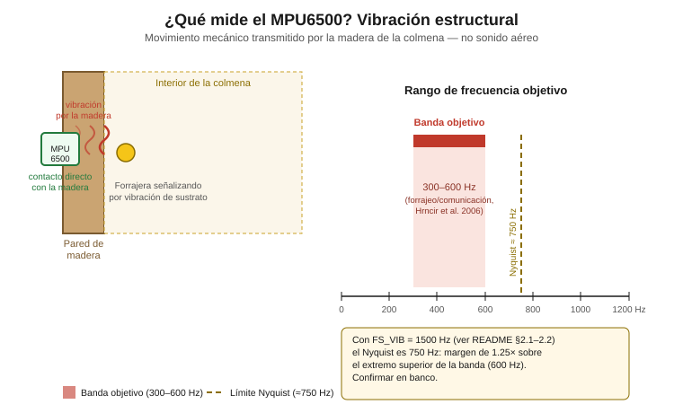

# MPU6050 / MPU6500 — Muestreo de vibración estructural (300–600 Hz)

Sensor de vibración estructural del sistema KaabLab. Vía este acelerómetro
se busca capturar señales vibracionales relacionadas con comportamiento
defensivo en *Melipona beecheii*, en la banda **300–600 Hz** reportada por
Hrncir et al. (2000, 2006a) para señalización vibracional en meliponinos (ver
`thesis/referencias.md`).

Documento dirigido a nivel licenciatura en mecatrónica: se explican tanto
los conceptos (Nyquist, DLPF, FIFO) como la configuración concreta.

> Sensor a instalar en contacto directo con la madera de la colmena (ver
> `CLAUDE.md`, sección "Decisiones de diseño confirmadas").

## Contenido de esta carpeta

| Archivo | Contenido |
|---|---|
| `README.md` | Este documento |
| `mpu6500_polling.ino` | Ruta A: polling con `MPU6500_WE`, muestreo a `FS_VIB` = 1500 Hz |
| `mpu6500_interrupt_fifo.ino` | Ruta B (opcional): interrupción INT + FIFO interno, diezmado a 1500 Hz |
| `diagrama_conexion.svg` | Esquema de conexión ESP32 DevKit V1 ↔ MPU6050/MPU6500 |
| `concepto_vibracion.svg` | Diagrama conceptual: qué es la vibración estructural medida y su rango de frecuencia objetivo |

---

## 0. ¿Qué mide este sensor y en qué rango?



El MPU6050 es un **acelerómetro MEMS**: mide aceleración lineal en sus
tres ejes, no sonido. En este proyecto, montado **en contacto directo con
la madera de la colmena**, esa aceleración captura la **vibración
estructural** — el movimiento mecánico de la pared del nido cuando las
abejas la excitan directamente golpeándola o presionándola con el cuerpo,
a diferencia del sonido aéreo (variación de presión que viaja por el
aire, captado por el INMP441 — ver `../sensor-audio/README.md`). En otros
meliponinos del género *Melipona* la señalización de forrajeo se expresa
por vibración de sustrato (Hrncir et al., 2000, 2006a); en *M. beecheii* no
está documentada.

**Rango de frecuencia objetivo: 300–600 Hz**, banda reportada por Hrncir
et al. (2000, 2006a) para señalización vibracional en meliponinos asociada al
forrajeo/comunicación. Con el MPU6500 (acelerómetro con salida
programable de hasta 4 kHz con el DLPF desactivado, sección 2.2) muestreado
a 1500 Hz, el **Nyquist es 750 Hz**: la banda completa de 300–600 Hz queda
cubierta con un margen de diseño de 1.25× sobre su límite superior
(sección 2.1). Queda pendiente confirmar en banco que la lectura por I²C
sostenga ese ritmo (sección 2.2).

---

## 1. Contexto del problema

La configuración por defecto de la mayoría de librerías Arduino para el
MPU6050 deja el sensor en:

- **Sample Rate ≈ 100 Hz** (registro `SMPLRT_DIV` con divisor por defecto)
- **DLPF activo** (filtro digital pasa-bajas interno habilitado, `DLPF_CFG` entre 1 y 6)

Por el **teorema de Nyquist**, una señal solo puede reconstruirse sin
ambigüedad (aliasing) si se muestrea a más del doble de la frecuencia
máxima de interés:

```
f_muestreo > 2 × f_señal_max
```

Con Sample Rate = 100 Hz, la frecuencia máxima representable sin aliasing
es 50 Hz (Nyquist = 100/2). La banda objetivo reportada por Hrncir et al.
(2000, 2006a) es **300–600 Hz** — muy por encima de esos 50 Hz. Con la
configuración por defecto, cualquier vibración en esa banda aparecería
como ruido de baja frecuencia (aliasing), no como la señal real.

**Conclusión:** la configuración por defecto es inutilizable para este
propósito. Es necesario reconfigurar el sample rate y el DLPF antes de
cualquier captura de banco.

---

## 2. Configuración objetivo

### 2.1 Criterio de muestreo

**Criterio único del proyecto:** el Nyquist debe ser **≥ 600 Hz** (límite
superior de la banda de interés, 300–600 Hz), con un **margen de diseño
recomendado de ~1.25×** sobre ese límite para tolerar la imprecisión del
filtro anti-aliasing (el acelerómetro no tiene un filtro pasa-bajas ideal
justo en el Nyquist). El margen es una holgura de diseño, no una exigencia
matemática del teorema de Nyquist.

```
Nyquist = FS_VIB / 2   →   objetivo: Nyquist ≥ 600 Hz × 1.25 = 750 Hz
                                     ⇒ FS_VIB ≥ 1500 Hz
```

| FS_VIB | Nyquist | Margen sobre 600 Hz | ¿Cumple el criterio (Nyquist ≥ 600 Hz, margen ~1.25×)? |
|---|---|---|---|
| 100 Hz (default de librerías) | 50 Hz | — | ❌ insuficiente (aliasing de toda la banda) |
| 1200 Hz | 600 Hz | 1.00× | ⚠️ cubre la banda sin margen de diseño |
| **1500 Hz (adoptada)** | **750 Hz** | **1.25×** | ✅ suficiente |

**Configuración adoptada: `FS_VIB = 1500 Hz`** (Nyquist = 750 Hz), igual en el
firmware (`../nodo_kaablab/config.h`) y en el pipeline
(`../kaablab_pipeline/config.py`).

### 2.2 El acelerómetro del MPU6500 no está limitado a 1 kHz

El **MPU6050** tiene el ADC del acelerómetro fijo en ~1 kHz, independiente de
`SMPLRT_DIV` (Register Map MPU-6000/6050, Registro 25), lo que dejaba el
Nyquist real en ~500 Hz, por debajo de la banda de 600 Hz. **Esa limitación
no aplica al hardware de los nodos**: el reemplazo por el **MPU6500**
(GY-6500) está confirmado, y según el datasheet oficial (MPU-6500 Product
Specification, Rev 1.1) su acelerómetro, en modo *low noise (active)*,
admite una tasa de salida programable de hasta **4000 Hz**.

Condiciones y configuración adoptada (firmware `../nodo_kaablab/` y `.ino`
de esta carpeta):

- El filtro digital programable (DLPF) del acelerómetro cubre un rango de
  5 a 260 Hz (datasheet, Tabla 2): con el DLPF activo se atenuaría la
  banda de 300–600 Hz. Debe **desactivarse** (`ACCEL_CONFIG2`, 0x1D,
  `accel_fchoice_b = 1`); el firmware lo hace con `enableAccDLPF(false)`.
- Con el DLPF desactivado la salida del acelerómetro corre a 4 kHz y el
  divisor `SMPLRT_DIV` no la modifica (los 1500 Hz no se obtienen por
  registro). La tasa `FS_VIB = 1500 Hz` se impone por temporización en el
  firmware: polling con periodo de ~667 µs en la Ruta A (sección 3.1) y
  diezmado del flujo de 4 kHz del FIFO en la Ruta B (sección 3.2). Como
  4 kHz > 1500 Hz, cada lectura entrega una muestra nueva del ADC.
- `FS_VIB = 1500 Hz` (elección de diseño, con margen hasta los 4000 Hz del
  chip): **Nyquist = 750 Hz**, que cubre los 600 Hz superiores de la banda
  con el margen de diseño de 1.25× definido en la sección 2.1.

**Pendiente de validación en banco:** el firmware muestrea por polling con
periodo de ~667 µs y no puede garantizarse en papel que la lectura I²C lo
sostenga (ver sección 2.3). `sensores_capturar_vibracion()` cuenta las
muestras que exceden el periodo esperado (+10 %, ~733 µs) y emite una
advertencia por Serial al terminar la ventana; ese contador debe revisarse
en la primera prueba con hardware real antes de confiar en
`FS_VIB = 1500 Hz` para captura de campo.

### 2.3 El bus I²C no es el cuello de botella

Límite físico del bus I²C del MPU6050: **400 kHz (Fast Mode)** — no es
configurable más allá de eso (el chip no soporta Fast Mode Plus ni High-Speed).

Cálculo de throughput para una lectura típica de 6 bytes (aceleración
X/Y/Z, 2 bytes cada eje) vía "escribir puntero de registro + repeated
start + leer N bytes":

```
Bits por transacción ≈ dirección+W (9) + registro (9) + repeated start +
                        dirección+R (9) + 6 bytes de datos (6×9=54)
                      ≈ 81 bits

Límite teórico del bus a 400 kHz:
  400 000 bits/s ÷ 81 bits ≈ 4938 transacciones/s
```

Ese es el límite *teórico* ignorando condiciones START/STOP y tiempo de
bus libre (`t_BUF`). En la práctica, con el overhead real del protocolo
I²C y de la librería `Wire` sobre ESP32, un estimado conservador realista
es de **~3000–4000 lecturas/s**.

**En cualquiera de los dos casos (teórico ~4900/s, conservador
~3000–4000/s), el bus I²C tiene margen sobrado sobre las 1500 lecturas/s
requeridas por la configuración objetivo de la sección 2.1.**

> **Nota explícita:** el bus I²C *no* es el riesgo. El riesgo real está en
> la eficiencia del firmware — específicamente, en **polling bloqueante**
> con `delay()`, que puede introducir jitter, perder ventanas de muestreo,
> o bloquear otras tareas del ESP32 (WiFi, otros sensores) mientras se
> espera. Por eso el código de la Ruta A (sección 3) evita `delay()` y usa
> temporización no bloqueante basada en `micros()`.

### 2.4 Nota sobre GPIO14

`CLAUDE.md` documenta un conflicto pendiente de resolver en GPIO14
(asignado simultáneamente a SCK de I²S para el INMP441 y a SDA de I²C).
Ese conflicto **no afecta a este sensor**: el MPU6050 en este proyecto usa
el bus I²C por defecto del ESP32 (SDA=GPIO21, SCL=GPIO22), no GPIO14. Se
deja la nota aquí solo para que quede claro que ambos temas son
independientes.

---

## 3. Código de manejo del sensor (ESP32)

Pin mapping confirmado del proyecto: **SDA = GPIO21, SCL = GPIO22**.

### 3.1 Ruta A — Polling con librería (recomendada para primera prueba)

Ver [`mpu6500_polling.ino`](./mpu6500_polling.ino).

Usa la clase **`MPU6500_WE`** (`MPU6500_WE.h`, librería **MPU9250_WE** de
Wolfgang Ewald, instalable desde el Library Manager), el mismo patrón que el
firmware del nodo (`../nodo_kaablab/sensores.cpp`). No se usa I2Cdevlib
(`MPU6050.h`): su `testConnection()` valida el `WHO_AM_I` del MPU6050 y
rechazaría al MPU6500 (`WHO_AM_I` = 0x70).

Puntos clave del código:

- Dirección I²C **0x69** (pin `AD0` a 3.3 V, para no chocar con el DS3231
  en 0x68) y verificación `imu.init()` + `imu.whoAmI() == 0x70`.
- Desactiva el DLPF del acelerómetro (`enableAccDLPF(false)`) y muestrea por
  polling a `FS_VIB` = 1500 Hz (periodo ~667 µs; sección 2.2).
- `Wire.setClock(400000)` para operar en I²C Fast Mode.
- El bucle principal usa temporización no bloqueante con `micros()` — **no
  usa `delay()`** — para respetar la nota de la sección 2.3.
- Imprime timestamp + valores crudos de aceleración por puerto serie en
  formato CSV, listo para capturar con un terminal serie o script y
  analizar (p. ej. FFT) en banco.

### 3.2 Ruta B — Interrupción + FIFO (opcional, solo si Ruta A pierde muestras)

Ver [`mpu6500_interrupt_fifo.ino`](./mpu6500_interrupt_fifo.ino).

Solo implementar esta ruta si la prueba de banco de la Ruta A (sección 5)
muestra pérdida de muestras. Usa el pin `INT` (data-ready) del MPU6500 y
el FIFO interno del sensor para que el ESP32 no tenga que hacer polling
continuo: el sensor avisa por interrupción cuando hay una muestra nueva,
y los datos se acumulan en su FIFO interno hasta que el ESP32 los retira
en bloque. Esto evita que el `delay()`/polling bloqueante consuma ciclos
del procesador. Como el flujo del FIFO corre a 4 kHz (sección 2.2), el
sketch lo diezma a `FS_VIB` = 1500 Hz con un acumulador de fase (conserva
1500 de cada 4000 muestras, con jitter temporal ≤ 250 µs).

El pin `INT` usado en el código es **GPIO13**, confirmado contra el
mapeo global de pines del proyecto (`thesis/capitulo-2-materiales-y-metodos/capitulo-2.md`,
Tabla 2.3) — reasignado desde GPIO4 para evitar el choque con el DATA
del DHT22 (GPIO4, 1-Wire).

---

## 4. Esquema de conexión

Ver [`diagrama_conexion.svg`](./diagrama_conexion.svg).

Incluye: VCC (3.3V), GND, SDA (GPIO21), SCL (GPIO22), y el pin INT
(marcado como opcional, solo necesario para la Ruta B).

---

## 5. Validación requerida antes de instalación en campo

**No dar por resuelta la Ruta A únicamente por inspección de código.**
Antes de instalar el sensor en una colmena, se requiere una prueba de
banco que confirme, con instrumentación externa (osciloscopio o
analizador lógico en el bus I²C, o un generador de vibración calibrado
sobre el que se monte el sensor):

1. **Que no hay pérdida de muestras** a la tasa configurada (1500 Hz) —
   comparar el número de transacciones I²C observadas en el analizador
   lógico contra las esperadas por segundo.
2. **Que la tasa de muestreo real y consistente** coincide con la
   configurada (verificar jitter entre muestras consecutivas del bucle
   `micros()`).
3. **Que el DLPF del acelerómetro quedó desactivado y cada lectura
   entrega información nueva** (sección 2.2) — por ejemplo, aplicando una
   vibración conocida de 300–600 Hz y verificando que la FFT no muestre
   atenuación por encima de ~260 Hz ni un "escalón" de valores repetidos.
4. Si se detecta pérdida de muestras con la Ruta A, implementar y probar
   la Ruta B (interrupción + FIFO) antes de continuar.

Solo después de esta validación de banco se debe considerar la
configuración lista para cableado final en campo.

---

## Referencias

- Hrncir et al. (2006a, 2006b): ver las entradas completas en
  `thesis/referencias.md`.
- InvenSense. *MPU-6500 Product Specification*, Rev 1.1 (tasa de salida
  del acelerómetro hasta 4 kHz, DLPF programable 5–260 Hz, Tabla 2).
- InvenSense. *MPU-6000 and MPU-6050 Register Map and Descriptions*
  (RM-MPU-6000A-00), Registro 25 (`SMPLRT_DIV`): limitación de 1 kHz del
  ADC del acelerómetro del MPU6050, que no aplica al MPU6500 (sección 2.2).
