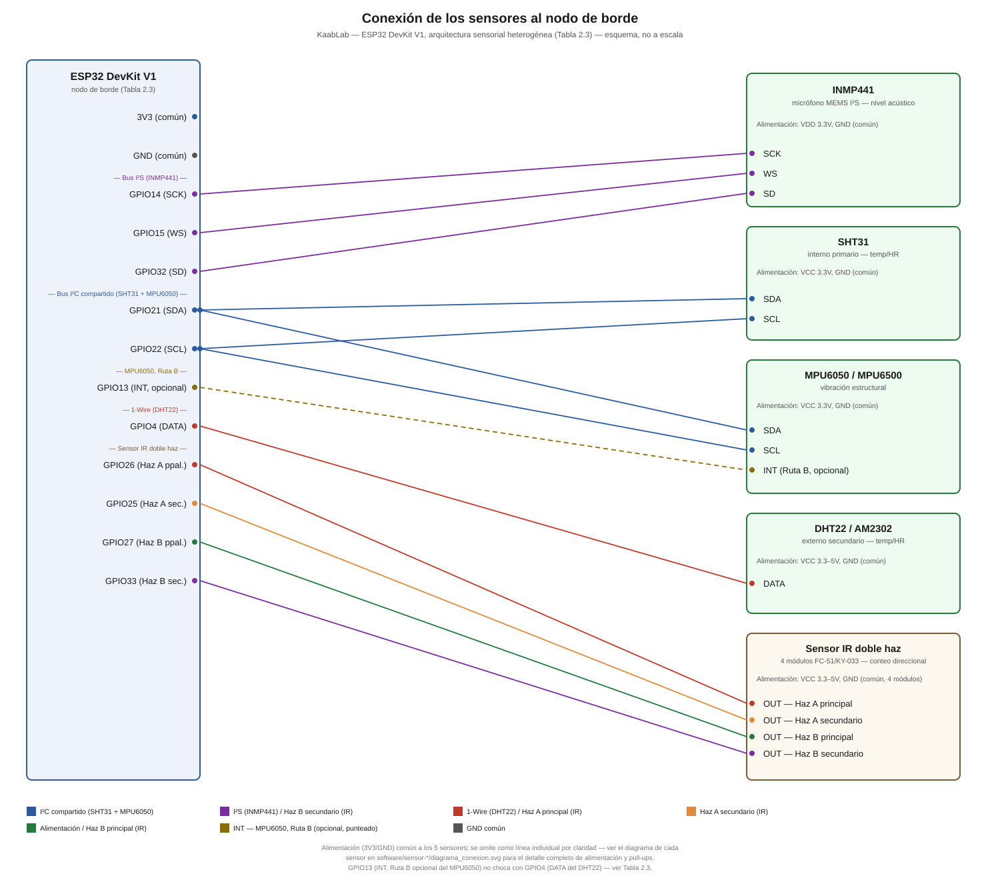
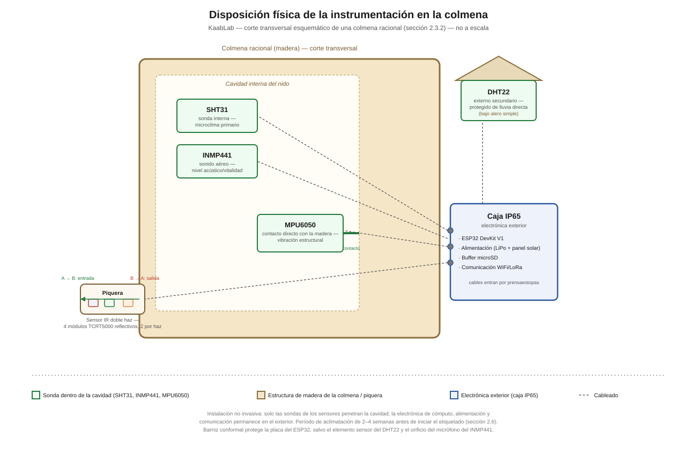
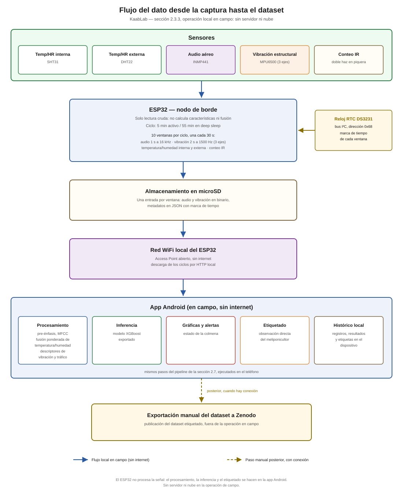

# CAPÍTULO II. MATERIALES Y MÉTODOS

## 2.1 Enfoque y diseño de investigación

La investigación adopta un enfoque mixto: cuantitativo en la evaluación del desempeño de los modelos de IA y de la arquitectura sensorial, y cualitativo en la evaluación de usabilidad. El diseño es experimental-aplicado, orientado al desarrollo y validación de un sistema tecnológico en condiciones reales.

| **Tipo** | **Enfoque** | **Diseño** |
| --- | --- | --- |
| Experimental-aplicado | Mixto (cuantitativo + cualitativo) | Experimental en módulos IA y sensores · No experimental en fase cualitativa |

**Tabla 2.1 **Diseño general de la investigación.

## 2.2 Arquitectura sensorial heterogénea con rangos complementarios

Una contribución de diseño original de esta tesis es la arquitectura sensorial heterogénea, que supera la arquitectura homogénea del artículo de referencia en tres dimensiones: fabricante distinto, principio físico distinto y rango de medición complementario. El principio que la fundamenta es que un sensor electrónico no mide directamente la magnitud física de interés, sino un fenómeno eléctrico secundario —variación de capacitancia, resistencia o voltaje— que convierte a la magnitud deseada mediante una función de calibración con limitaciones físicas conocidas (saturación, histéresis, deriva, sensibilidad al rango).

| **Parámetro** | **Sensor** | **Principio físico** | **Rango óptimo** | **Rol** | **Limitación conocida** |
| --- | --- | --- | --- | --- | --- |
| Temp + HR interna | SHT31 | Capacitivo de película polimérica | 0–100% HR · ±2% HR | Interno primario | Autocalibración >80–85% HR · requiere I²C |
| Temp + HR externa | DHT22 | Capacitivo higroscópico | 0–80% HR · −40–80 °C | Externo secundario | Degrada sin recuperación a HR sostenida alta · histéresis |
| Nivel acústico / vitalidad | INMP441 | MEMS capacitivo | 60 Hz–15 kHz | Estado general de la colonia | Capta sonido aéreo; no capta vibración de sustrato |
| Vibración estructural / defensivo | MPU6500 | Acelerómetro MEMS | 180–600 Hz (vuelo 180–250 + forrajeo 300–600; muestreo a 1.5 kHz, Nyquist 750 Hz, sin recorte) | Comportamiento defensivo (sustrato) | Requiere contacto con madera |
| Conteo de tráfico | IR doble haz | Módulo integrado FC-51/KY-033 (LED 940 nm + fototransistor + comparador LM393), 4 módulos / 2 pares | Direccional (entrada/salida) | Proxy de forrajeo y vitalidad | Sensible a luz solar directa sin filtro; distancia mínima de detección (20–300 mm) mayor al diámetro del tubo (~15 mm), pendiente de validar |

**Tabla 2.2 **Arquitectura sensorial heterogénea: fabricante, principio físico, rango, rol y limitación por sensor.

### 2.2.1 Fundamento físico de la humedad: SHT31 interno primario y DHT22 externo secundario

El SHT31 y el DHT22 son ambos sensores capacitivos de humedad, pero se asignan a ubicaciones y roles distintos en la colmena. El SHT31 se instala como sensor **interno primario**: su sonda encapsulada mide el microclima directamente dentro de la cavidad del nido, con precisión declarada de ±2% HR en todo el rango 0–100%. El DHT22 se instala como sensor **externo secundario**, expuesto a las condiciones ambientales fuera de la colmena, sin contacto con el microclima interno.

Ambos sensores contienen internamente dos placas conductoras separadas por un material higroscópico que absorbe vapor de agua del aire; el circuito mide la capacitancia resultante y la convierte a porcentaje de HR mediante una tabla de calibración interna. Lo que cada sensor mide realmente es una diferencia de carga eléctrica entre dos placas, no humedad directamente, y ambos principios físicos comparten limitaciones de rango: por encima de aproximadamente 80–85% HR el SHT31 interno **se autocalibra**, recuperando precisión tras el evento de saturación por el propio algoritmo de compensación del fabricante; el DHT22 externo, de tecnología menos sofisticada, **degrada sin recuperación** bajo HR sostenida alta —el material higroscópico se satura y el sensor reporta valores estables aunque la HR real siga aumentando, sin mecanismo de autocorrección—. En temporada de lluvias en Campeche (mayo–octubre), la HR exterior frecuentemente supera el 85%, precisamente el rango donde el DHT22 externo pierde fiabilidad de forma persistente.

Adicionalmente, el DHT22 presenta histéresis: absorbe vapor de agua rápido pero lo libera lento. Si la HR sube de 60% a 90% en 10 minutos y luego baja a 60%, el sensor puede reportar valores elevados durante varios minutos adicionales porque el material aún no liberó toda la humedad absorbida.

La separación física interno/externo convierte la comparación entre ambos sensores en una variable diagnóstica en sí misma, no solo en redundancia: dado que *Melipona beecheii* es termoconformadora, no termorreguladora activa —su temperatura interna es más estable durante el día (9:00-20:00h) que durante la noche, cuando sigue más de cerca la fluctuación externa (Moo-Valle et al., 2000)—, el **contraste entre la lectura interna del SHT31 y la externa del DHT22** —y no el valor absoluto interno por sí solo— es la variable relevante para la detección de anomalías térmicas e higrométricas (véase también sección 1.1.5b).

<!-- REVISAR CON ASESOR: confirmar umbrales de temperatura y HR provisionales listados en CLAUDE.md antes de fijarlos en el vector de características -->

### 2.2.2 Fundamento físico del INMP441 y el MPU6500 como sensores complementarios

El INMP441 es un micrófono MEMS (Micro-Electro-Mechanical System). Contiene una membrana muy delgada que vibra con las variaciones de presión del aire (sonido aéreo). Esa vibración modifica la capacitancia entre la membrana y una placa fija, y el circuito convierte esa variación en voltaje. Su rango frecuencial efectivo es aproximadamente 60 Hz–15 kHz (Suárez Carvajal, 2025), lo que lo hace adecuado para captar el **nivel acústico general y el estado de vitalidad de la colonia** —no el comportamiento defensivo—, pero no registra la vibración de sustrato del nido (sí su componente de sonido aéreo) en el rango de 180–600 Hz (vuelo ~180–250 Hz, Hrncir et al., 2008; forrajeo/reclutamiento ~300–600 Hz, Hrncir et al., 2000, 2006a).

En otros meliponinos se ha descrito el comportamiento defensivo mediante vibración del sustrato del nido (dos Santos et al., 2025); en *M. beecheii* no está documentado. El comportamiento defensivo de *M. beecheii*, por tanto, no está caracterizado acústicamente y no puede inferirse confiablemente a partir del INMP441 sin datos propios; su rol en esta arquitectura se limita al nivel acústico como proxy de vitalidad y actividad general de la colonia. El MPU6500 es un acelerómetro MEMS de 6 ejes (3 de aceleración + 3 de giroscopio), montado en contacto directo con la madera de la colmena, que captura el rango de vibración estructural de 180–600 Hz (vuelo ~180–250 Hz, forrajeo/reclutamiento ~300–600 Hz) donde, en esos grupos, ocurre la señalización defensiva. Con el filtro digital desactivado, su salida del acelerómetro es programable hasta 4 kHz; el firmware muestrea a 1.5 kHz (Nyquist de 750 Hz, con un margen de diseño de 1.25× sobre el límite superior de 600 Hz de la banda), por lo que la banda completa se captura sin recorte. Los dos sensores son físicamente complementarios y cubren fenómenos distintos: el INMP441 aporta nivel acústico/vitalidad; el MPU6500 aporta comportamiento defensivo vía vibración estructural.

### 2.2.3 Sensor IR doble haz — conteo de tráfico en piquera

El sensor IR doble haz añade un cuarto tipo de señal a la arquitectura: el conteo direccional de tráfico de forrajeras en la piquera, como proxy de la actividad de forrajeo y de la vitalidad general de la colonia.

La arquitectura vigente usa **cuatro módulos comerciales integrados FC-51/KY-033** (LED emisor IR de 940 nm, fototransistor receptor, comparador LM393 y potenciómetro de sensibilidad en una sola placa), organizados en **dos pares emisor-receptor** —uno por haz—, alineados perpendicularmente al eje de tránsito de la piquera. Como cada módulo integra emisor y receptor en la misma placa (diseño originalmente pensado para detección reflectiva, no de haz directo), no es posible formar los dos haces cruzados con solo dos unidades: se requiere un par completo (dos módulos enfrentados) por cada haz. La lógica de conteo es secuencial: si el haz A se interrumpe antes que el haz B, se registra una entrada (A→B); si el haz B se interrumpe antes que el haz A, se registra una salida (B→A).

La separación entre los dos haces es de aproximadamente 4 mm, deliberadamente menor a la longitud del cuerpo de una obrera de *M. beecheii* (~10 mm), de modo que un mismo individuo interrumpa ambos haces en secuencia y no simultáneamente. El sensor se embebe en un barreno de aproximadamente 15 mm de diámetro practicado en una pared de madera de al menos 25 mm de espesor, alineado con el túnel de la piquera.

Pines de conexión: cada par entrega al ESP32 la señal digital `OUT` de sus dos módulos —uno declarado receptor principal, el otro secundario, para redundancia/diagnóstico en banco, dado que ambos módulos de un par tienen fototransistor propio—: haz A → GPIO26 (principal) y GPIO25 (secundario); haz B → GPIO27 (principal) y GPIO33 (secundario). Los módulos no requieren señal de drive de LED desde el ESP32: el LED de cada uno se alimenta directamente de VCC/GND.

Precedente parcial en congéneres: Justino y Hartfelder (2024), quienes registraron actividad continua en el túnel de entrada de *Melipona quadrifasciata* con un detector IR simple, sin diferenciar direccionalidad — a diferencia del diseño direccional de doble haz de esta tesis. Costo estimado por módulo: ~$30–50 MXN (cuatro módulos por nodo).

**Nota de validación pendiente (diseño no cerrado):** los módulos FC-51/KY-033 especifican una distancia mínima de detección de 20–300 mm, mayor que el diámetro del barreno de ~15 mm donde se embeben. Esta discrepancia no está resuelta por diseño: debe confirmarse en banco, antes de la instalación en campo, que los módulos detectan de forma fiable a la distancia real de montaje y sin falsos positivos por saturación a corta distancia. Tampoco hay mitigación integrada contra falsos positivos por luz solar IR directa —a diferencia de un diseño con modulación IR activa del LED emisor, descartado en esta arquitectura—; se depende únicamente del blindaje mecánico del tubo de madera de la piquera. Si la validación en banco falla, se deja como alternativa a evaluar el rediseño con circuito discreto (fototransistor tipo PT333-3B + comparador LM393 + transistor driver para el LED), que sí permite ajustar libremente la distancia física y añadir modulación del emisor. Ver `software/sensor-trafico/README.md` y `CLAUDE.md`, sección "Pendientes técnicos".

<!-- REVISAR CON ASESOR: confirmar separación exacta entre haces y protocolo de montaje en la caja racional -->
<!-- REVISAR CON ASESOR: validar en banco distancia mínima de detección real del sensor IR vs. diámetro del barreno de la piquera (ver nota arriba) -->

### 2.2.4 Fusión sensorial ponderada por confianza

La fusión sensorial ponderada por confianza asigna a cada sensor un peso dinámico que depende de si la lectura actual está dentro de su rango de máxima precisión, y se complementa con el contraste interno-externo descrito en la sección 2.2.1. El algoritmo opera en tres pasos:

- **Paso 1 — Detección de rango: **para cada lectura ambiental, se determina si está dentro del rango óptimo del sensor. Si la lectura del SHT31 interno supera 80–85% HR (umbral de aproximación a su autocalibración), su peso se reduce progresivamente durante el evento de recalibración.

- **Paso 2 — Contraste interno-externo: **se calcula la diferencia entre la lectura interna (SHT31) y la externa (DHT22). Esta diferencia no se trata como error de medición a promediar, sino como variable diagnóstica de termoconformidad (sección 2.2.1). Si el patrón día/noche de esa diferencia se aparta del comportamiento esperado (mayor estabilidad interna durante el día, seguimiento más cercano del exterior durante la noche), se marca como posible anomalía.

- **Paso 3 — Vector final: **el valor interno (SHT31), el valor externo (DHT22) y su contraste se concatenan como tres campos distintos del vector de características, en lugar de fusionarse en un único valor promediado, preservando la información diagnóstica de cada rol.

Para la señal acústica, las características extraídas del INMP441 (MFCCs, ZCR, centroide espectral) y del MPU6500 (energía de vibración por bandas de frecuencia, pico de vibración, varianza de aceleración) se concatenan como bloques separados del vector de características, permitiendo al modelo aprender la contribución independiente de cada fuente. El conteo IR (entradas, salidas, tasa neta por intervalo) se concatena como un bloque adicional.

## 2.3 Instrumentación y flujo de adquisición de datos (IoT)

El subsistema IoT cumple una función central: convertir el estado físico de la colmena en registros digitales fiables y entregarlos al subsistema de IA como un dataset estructurado. Se describe en tres bloques: la conexión de los sensores al nodo de cómputo, su disposición física en la colmena, y el flujo del dato desde la captura hasta el almacenamiento.

### 2.3.1 Conexión de los sensores

Todos los sensores convergen en un único nodo de borde (ESP32 DevKit V1), que concentra la adquisición y la primera etapa de transmisión. La heterogeneidad de la arquitectura obliga a convivir varios protocolos distintos en el mismo microcontrolador: 1-Wire para el DHT22, I²C para el SHT31 y el MPU6500 (que comparten bus con direcciones 0x44 y 0x68 sin conflicto), I²S para el micrófono digital INMP441, y GPIO digital para el sensor IR doble haz. Resistencias pull-up de 10 kΩ estabilizan la línea de datos del DHT22 y el bus I²C. La Figura 2.1 resume la conexión y la Tabla 2.3 detalla los protocolos y pines.

**Figura 2.1 **Conexión de los sensores al nodo de borde.

| Sensor | Señal | Pin |
| --- | --- | --- |
| INMP441 (I²S) | SCK | GPIO14 |
| INMP441 (I²S) | WS | GPIO15 |
| INMP441 (I²S) | SD | GPIO32 |
| SHT31 + MPU6500 (I²C) | SDA | GPIO21 |
| SHT31 + MPU6500 (I²C) | SCL | GPIO22 |
| DHT22 (1-Wire) | DATA | GPIO4 |
| Contador IR doble haz | Haz A (principal) | GPIO26 |
| Contador IR doble haz | Haz A (secundario) | GPIO25 |
| Contador IR doble haz | Haz B (principal) | GPIO27 |
| Contador IR doble haz | Haz B (secundario) | GPIO33 |
| MPU6500 (interrupción opcional) | INT (Ruta B, opcional) | GPIO13 |

**Tabla 2.3 **Protocolos de comunicación y pines por sensor (ESP32 DevKit V1).

Direcciones I²C del bus compartido: SHT31 en 0x44 u 0x45, MPU6500 en 0x68 u 0x69 — sin conflicto entre sí. Opcionalmente, si el muestreo por polling del bus I²C muestra pérdida de muestras en la prueba de banco, el MPU6500 puede operar además por interrupción data-ready, usando GPIO13 para la señal INT — sin conflicto con el resto del mapeo de pines.

### 2.3.2 Disposición física en la colmena

El principio de instalación es no invasivo: solo las sondas de los sensores penetran la cavidad; la electrónica de cómputo, alimentación y comunicación permanece en el exterior dentro de una caja IP65. La sonda encapsulada del SHT31 se introduce al interior de la cavidad como sensor primario de microclima; el DHT22 permanece montado en el exterior de la colmena, protegido de la lluvia directa, como sensor secundario de referencia ambiental; el INMP441 capta el sonido aéreo dentro de la cavidad; el MPU6500 se fija en contacto directo con la madera para registrar la vibración estructural; y el sensor IR doble haz se embebe en el barreno de la piquera (sección 2.2.3). Se respeta un período de aclimatación de 2–4 semanas antes de iniciar el etiquetado (véase también sección 2.6), y el barniz conformal protege la placa salvo el elemento sensor del DHT22 y el orificio del micrófono (Figura 2.2).

**Figura 2.2 **Disposición física de la instrumentación en la colmena.

### 2.3.3 Flujo del dato: de la captura al dataset

El ESP32 opera en muestreo periódico (5 minutos activo / 55 dormido) para preservar autonomía. Cada ciclo escribe las lecturas en un buffer local en microSD y, cuando hay enlace disponible, las transmite de forma inalámbrica. Conviene una precisión de ingeniería: el audio solo puede viajar por WiFi, que ofrece ancho de banda suficiente; LoRa queda reservado para telemetría ambiental y de conteo IR ligera en sitios remotos sin cobertura. Por ello el diseño es inalámbrico con respaldo local: si no hay enlace, el dato espera en la microSD y se sincroniza de forma diferida. En el servidor, el meliponicultor etiqueta los registros por observación directa y se consolidan en el dataset (audio y vibración en Parquet; conteo IR y variables ambientales en series de tiempo estructuradas), publicado finalmente en Zenodo (Figura 2.3).

**Figura 2.3 **Flujo del dato desde la captura hasta el dataset.

## 2.4 Protocolo de preprocesamiento de señal

El artículo de referencia no documentó ningún protocolo de preprocesamiento de señal antes de la extracción de características. Esta tesis introduce un protocolo formal, justificado por la naturaleza indirecta de las mediciones sensoriales y las condiciones climáticas tropicales de Campeche.

### 2.4.1 Filtro de media móvil sobre variables ambientales

Antes de concatenar las variables ambientales al vector de características, se aplica un filtro de media móvil de ventana de 5 muestras sobre temperatura y HR, tanto interna (SHT31) como externa (DHT22). Este filtro suaviza los picos espurios causados por la histéresis del DHT22, el ruido eléctrico de la batería y las variaciones abruptas de HR durante aguaceros. La ventana de 5 muestras equivale a 5 minutos de lecturas (una muestra por minuto), suficiente para suavizar picos transitorios sin introducir latencia significativa en la detección de cambios reales del estado de la colmena.

### 2.4.2 Pre-énfasis sobre la señal de audio

Antes de la extracción de MFCCs, se aplica un filtro de pre-énfasis de primer orden sobre la señal de audio cruda: y[n] = x[n] − 0.97 · x[n−1]. Este filtro amplifica las frecuencias altas relativas a las bajas, compensando la tendencia natural del micrófono INMP441 a captar con mayor energía las frecuencias graves. El pre-énfasis mejora la discriminabilidad de los coeficientes MFCC de orden alto, que capturan información sobre los armónicos y la textura fina de la señal acústica de la colmena.

### 2.4.3 Umbral de energía RMS para descarte de segmentos silenciosos

No todos los segmentos de 60 segundos contienen señal de colmena útil. Durante períodos de baja actividad nocturna, o si el micrófono se desconecta momentáneamente, el segmento puede contener principalmente ruido de fondo. Se calcula la energía RMS (Root Mean Square) de cada segmento y se descarta si cae por debajo de un umbral empírico determinado durante la fase de calibración inicial en cada meliponario. Los segmentos descartados se registran como datos faltantes y no se usan para entrenamiento ni inferencia.

### 2.4.4 Normalización Z-score del vector de características

Antes de entrenar los modelos, el vector de características completo —MFCCs, ZCR, centroide espectral, variables ambientales interna/externa y su contraste, características de vibración del MPU6500 y conteo IR— se normaliza mediante Z-score por colmena: a cada valor se le resta la media y se divide entre la desviación estándar calculada sobre el conjunto de entrenamiento de esa colmena. Esto garantiza que las variables de diferentes escalas tengan contribuciones comparables al modelo, sin que ninguna domine por su magnitud absoluta. El artículo de referencia no documentó esta normalización, lo que puede haber favorecido a variables de mayor escala en los modelos sensibles a la escala (SVM).

### 2.4.5 Conversión de humedad relativa a humedad absoluta

La humedad relativa (HR) depende de la temperatura: la misma cantidad real de vapor de agua produce lecturas de HR completamente distintas si la temperatura cambia. Por ejemplo, 10 g/m³ de vapor de agua producen HR = 57.8% a 20 °C, HR = 32.9% a 30 °C y HR = 25.3% a 35 °C, sin que el contenido de vapor haya variado. Concatenar HR directamente al vector de características, como hace el artículo de referencia, introduce una covariancia artificial con la temperatura que puede confundir al modelo.

Antes de concatenar las variables ambientales, se convierte la humedad relativa a humedad absoluta (HA, en g/m³) mediante la aproximación de Magnus: HA = 6.112 × e^(17.67·T/(T+243.5)) × HR / (461.5 × (T+273.15)), donde T es la temperatura en grados Celsius y HR la humedad relativa en tanto por uno. El resultado es el contenido real de vapor de agua, físicamente relevante para el desarrollo de hongos, la ventilación colectiva de *M. beecheii* y las condiciones patológicas de la colmena. La conversión se aplica tanto al SHT31 interno como al DHT22 externo, conservándose ambos valores de humedad absoluta —y su contraste— como campos independientes del vector de características (sección 2.2.4), en lugar de fusionarse en un único valor promediado.

## 2.5 Arquitectura del sistema KaabLab completo

El sistema KaabLab para *M. beecheii* se organiza en cuatro capas funcionales, que expanden las tres del artículo de referencia con la adición de la capa de preprocesamiento:

- **Capa ****IoT**** (instrumentación heterogénea): **SHT31 interno + DHT22 externo (temperatura/HR) + INMP441 (nivel acústico) + MPU6500 (vibración estructural) + sensor IR doble haz en piquera (conteo de tráfico) + ESP32 o Raspberry Pi 4 como edge device + batería LiPo 5,000–10,000 mAh + panel solar 5–10 W.

- **Capa de preprocesamiento: **fusión sensorial ponderada por confianza y contraste interno-externo (SHT31 + DHT22) → filtro de media móvil → pre-énfasis de audio (α = 0.97) → umbral RMS → normalización Z-score del vector completo.

- **Módulo ****bioacústico y sensorial: **extracción de MFCCs (n=13, media y desviación), ZCR, centroide y rolloff espectral del INMP441; energía de vibración por bandas, pico y varianza de aceleración del MPU6500; conteo direccional del sensor IR; concatenación con variables ambientales interna/externa y su contraste; clasificación con XGBoost, Gradient Boosting, RF y SVM; optimización en dos fases (búsqueda aleatoria 20 it. + bayesiana 15 it., 3-fold CV).

- **Capa de alertas y evidencia: **umbral de confianza 0.7; registro de clase + confianza + timestamp en JSON local; sincronización diferida.

## 2.6 Consideraciones de interferencia del hardware IoT en *M. beecheii*

<!-- REVISAR CON ASESOR: confirmar protocolo de aclimatación y si requiere registro de comportamiento antes/después de instalación -->

La instrumentación electrónica introducida en o cerca del nido no es neutra: puede alterar el mismo comportamiento que se busca monitorear. Se identifican cuatro vectores de interferencia potencial:

1. **Campos electromagnéticos del ESP32/RPi (WiFi 2.4 GHz). **Riesgo teórico sobre la magnetorrecepción de las abejas, cuyo mecanismo sensorial podría verse afectado por campos electromagnéticos de radiofrecuencia cercanos al nido.

2. **Calor generado por el hardware (~5 W en la Raspberry Pi 4). **Puede alterar localmente el balance térmico de *M. beecheii*, especie termoconformadora cuyo rango de temperatura intranidal documentado es de 25.4-34.0°C, con media de 30.2°C (Moo-Valle et al., 2000).

3. **Vibraciones mecánicas del propio hardware. **Ventiladores, relés o vibración de componentes pueden contaminar las lecturas del MPU6500, introduciendo ruido no biológico en la señal de vibración estructural.

4. **Luz IR del sensor de conteo. **El LED IR de 940 nm del sensor de piquera podría tener un efecto no caracterizado sobre los ritmos circadianos de la colonia si su exposición es continua.

Protocolo de instalación mínimamente invasiva:

- Período de aclimatación de 2–4 semanas antes de iniciar el etiquetado del dataset, permitiendo que la colonia se habitúe a la presencia del hardware.
- El ESP32 opera en modo de transmisión periódica (5 minutos activo / 55 dormido), no WiFi continuo, para minimizar el tiempo de exposición a campos electromagnéticos.
- La electrónica de procesamiento, alimentación y comunicación se monta externamente a la colmena; solo las sondas de los sensores (SHT31, INMP441, MPU6500) y el sensor IR penetran o hacen contacto con la cavidad o sus paredes.

## 2.7 Pipeline de procesamiento y evaluación (IA)

El subsistema de IA toma el dataset crudo y lo transforma, etapa por etapa, en un diagnóstico de la condición de la colmena. Entran cuatro modalidades alineadas por timestamp: audio aéreo (INMP441), vibración estructural (MPU6500), variables ambientales interna/externa (SHT31 + DHT22) y conteo de tráfico en piquera (IR doble haz). La limpieza aplica el protocolo de preprocesamiento descrito en la sección 2.4. La extracción de características produce, del audio, los MFCC, ZCR, centroide y rolloff espectral; del MPU6500, la energía de vibración por bandas, el pico y la varianza de aceleración; del sensor IR, entradas, salidas y tasa neta por intervalo; concatenados con la humedad absoluta interna/externa y su contraste. El clasificador bioacústico —XGBoost / Gradient Boosting— integra estas fuentes para producir el diagnóstico de la condición de la colmena (objetivo AUC-ROC ≥ 0.85, F1 ≥ 0.80) —sana, anomalía bioacústica o anomalía de vibración/comportamiento defensivo—, con registro de evidencia cuando la confianza supera 0.7 (Figura 2.4).

**Figura 2.4 **Pipeline de procesamiento y evaluación de IA.

## 2.8 Justificación técnica de las decisiones de diseño de IA

### 2.8.1 Número de coeficientes MFCC (n = 13)

La selección de n = 13 coeficientes MFCC sigue el estándar de la literatura de bioacústica de colmenas (Uthoff et al., 2023) y fue validada en el artículo de referencia: CV F1 = 0.9336 ± 0.0085 con XGBoost. Con n = 13, cada coeficiente se representa con media y desviación estándar, generando 26 valores acústicos por segmento. Valores mayores incrementan la dimensionalidad sin aportar información discriminativa adicional y elevan el riesgo de sobreajuste con datasets pequeños.

### 2.8.2 Validación cruzada de 3 pliegues

Con datasets estimados de 2,000–5,000 registros, la diferencia en el balance sesgo-varianza entre 3-fold y 5-fold CV es mínima. El artículo de referencia lo demostró: desviaciones estándar de F1 de 0.0085 con 3-fold CV y 7,100 registros. La ganancia de la fase bayesiana sobre la búsqueda aleatoria fue de 0.0005 F1, confirmando que 20 iteraciones de búsqueda aleatoria identifican adecuadamente las regiones óptimas del espacio de hiperparámetros.

### 2.8.3 XGBoost y Gradient Boosting

Su superioridad sobre redes neuronales profundas para datos tabulares con datasets pequeños se explica por tres razones: la regularización L1+L2 reduce el sobreajuste; el boosting secuencial reduce sesgo y varianza simultáneamente; y no requieren normalización estricta. Superaron a Regresión Logística y KNN por 5–14 pp de F1 en el artículo de referencia.

## 2.9 Protocolo de construcción del dataset

### 2.9.1 Recolección de datos bioacústicos, de vibración y ambientales

Segmentos de 60 segundos a 22,050 Hz (INMP441) y datos de vibración estructural simultáneos (MPU6500 a 1.5 kHz), con variables ambientales interna (SHT31) y externa (DHT22) registradas por separado. Seis clases de estado de salud siguiendo la taxonomía del artículo de referencia. Etiquetado por observación directa del meliponicultor. Meta: ≥ 1,000 registros de *M. beecheii* en el primer semestre.

### 2.9.2 Recolección de datos de conteo IR en piquera

Registro continuo de cruces de haz (entradas y salidas) del sensor IR doble haz, agregado en intervalos de 5 minutos alineados con el resto de las modalidades. Etiquetado indirecto por correlación con observación directa de actividad de forrajeo. Meta de precisión de conteo por definir durante la calibración del Semestre 1 (sección 2.10).

### 2.9.3 Manejo del desbalance de clases

AUC-ROC como métrica principal, funciones de pérdida ponderadas, data augmentation extensivo y SMOTE si el desbalance supera 1:10.

### 2.9.4 Partición y almacenamiento del dataset

División 70/15/15 con estratificación por clase. Formato Parquet (audio y vibración) y series de tiempo estructuradas (ambientales y conteo IR). Publicación en Zenodo CC BY 4.0 al concluir.

## 2.10 Métricas de evaluación

| **Módulo** | **Métrica** | **Umbral objetivo** | **Ref. *Apis mellifera*** |
| --- | --- | --- | --- |
| Arquitectura sensorial — HR <80% | Contraste SHT31 (interno) vs DHT22 (externo) | Diferencia consistente con patrón de termoconformidad (mayor estabilidad interna de día que de noche) | N/A (nuevo) |
| Arquitectura sensorial — HR >85% | Precisión SHT31 vs DHT22 | DHT22 <±8% · SHT31 <±3% | N/A (nuevo) |
| Bioacústico — estado de salud | F1 ponderado | ≥ 0.80 | 0.933 (XGBoost) |
| Bioacústico — ausencia de reina | AUC-ROC | ≥ 0.85 | 0.991 (XGBoost) |
| Conteo IR — tráfico en piquera | Precisión de conteo | Por definir en Semestre 1 | N/A (nuevo) |
| Sistema — autonomía IoT | Horas de operación | ≥ 72 h | N/A |
| Sistema — latencia de alerta | Detección a alerta | < 60 s | N/A |

**Tabla 2.4 **Métricas de evaluación con umbrales objetivo y benchmarks de referencia.
